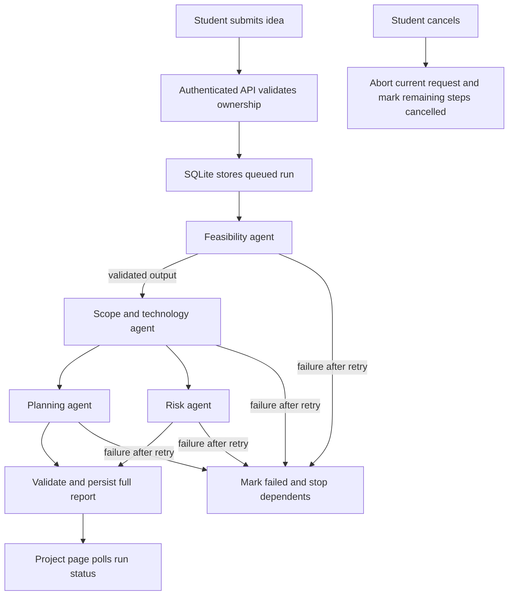

# ProjectMentor AI demo guide

## Before the demo

1. Use Node.js 22.13 or newer and run `npm install` in the project folder.
2. Copy `.env.example` to `.env`.
3. Put a fresh random value in `JWT_SECRET` and your OpenAI API key in `LLM_API_KEY`. Keep `.env` private; never paste either value into chat, screenshots, source code, or `VITE_` variables.
4. Keep `VITE_API_BASE_URL=http://127.0.0.1:3000` for the authenticated backend. Confirm the provider and database status at `http://127.0.0.1:3000/health`.
5. Start `npm run dev:api` and `npm run dev` in separate terminals.

## Live walkthrough

1. Register a student account and sign in.
2. Complete onboarding with a few realistic skill ratings and weekly hours.
3. Submit an idea with a clear goal and duration.
4. Show the pipeline page: feasibility runs first, scope follows it, then planning and risk run in parallel. Each row updates from queued to running and completed.
5. Open the report and discuss feasibility evidence, scope boundaries, recommended stack, milestones, and mitigations.
6. If time permits, start another analysis and cancel it while a step is running; show the cancelled state.
7. Demonstrate record isolation by signing into a second account. The first account's projects should not appear.

## Safe test flow

- Use fictional student/project data for the demo.
- Submit only one or two live projects; each successful run makes four OpenAI calls and each agent can retry once. Output is capped at 1,600 tokens per attempt.
- To demo failures without API calls, remove `LLM_API_KEY`, restart the backend, and show the clear configuration error. For network/API error paths, use the automated mocked tests rather than repeatedly submitting paid requests.
- Check provider usage after live testing. API billing is separate from ChatGPT billing.

## Workflow

## Known limitations

- SQLite, in-memory login throttling, and the in-process run worker are for a single-machine classroom demo; restarts can interrupt active runs.
- Password reset is intentionally disabled until verified email recovery is implemented.
- The browser keeps a bearer session token in local storage. Use secure, httpOnly cookies, HTTPS, CSRF defenses, and a production identity/security review before public deployment.
- Every agent has one retry; repeated rate limits or invalid output still fail the run.
- OpenAI output is advisory. Students and faculty should review feasibility, technology choices, estimates, and risks.
- This demo does not include faculty roles, mentor chat, report generation, database migrations, durable queues, or deployment monitoring.
